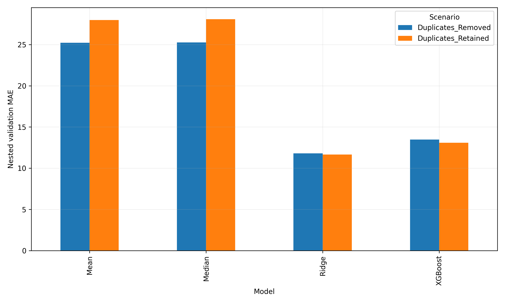

# Photocatalysis: Ridge and XGBoost Comparison

**Author: Shahid Ali**

Independent computational reanalysis of published experimental data on malachite green removal using bismuth ferrite-based photocatalysts.

## Objective

Compare Ridge regression and XGBoost for predicting degradation efficiency, with attention to grouped validation, overfitting, and duplicate-record sensitivity.

## Data source and credit

The experimental data were produced by the original researchers, not by me.

Jaffari et al., “Machine learning approaches to predict the photocatalytic performance of bismuth ferrite-based materials in the removal of malachite green.”

- Paper: https://doi.org/10.1016/j.jhazmat.2022.130031
- Original data and code: https://github.com/ZeeshanHJ/Photocatalytic_Performance_Prediction

Download `Raw data.csv` from the original repository. The raw dataset is not redistributed here.

## Methods

- Dataset: 1,200 observations.
- Target: degradation efficiency (%).
- Final concentration was excluded from predictors to prevent target leakage.
- Categorical features were one-hot encoded within each training pipeline.
- Measurements with matching recorded experimental conditions, excluding time, were assigned to the same group.
- A held-out partition contained 8 condition groups; the training partition contained 31 groups.
- Nested validation used five outer folds and up to four inner grouped folds on the training partition.
- Ridge and XGBoost were compared with mean and median baselines.
- Exact duplicate records were retained in the primary analysis and removed in a sensitivity analysis.

## Results

Nested grouped validation on the training partition:

| Duplicate handling | Model | Pooled R² | MAE | RMSE |
|---|---|---:|---:|---:|
| Retained | Ridge | 0.755 | 11.65 | 15.85 |
| Retained | XGBoost | 0.640 | 13.10 | 19.22 |
| Removed | Ridge | 0.711 | 11.79 | 15.65 |
| Removed | XGBoost | 0.600 | 13.47 | 18.44 |

MAE and RMSE are measured in efficiency percentage points. The two duplicate scenarios contain different evaluation-row counts; see `Duplicate_Sensitivity_Common_Rows.csv` for comparison on identical rows.

XGBoost achieved R² = 0.632, MAE = 16.32, and RMSE = 19.12 on the held-out partition. A final held-out Ridge evaluation has not yet been completed.

**Main finding:** Ridge outperformed XGBoost under the nested grouped validation design.

## Repository contents

- `Shahid_Ali_Photocatalysis_ML_Comparison.ipynb`: modelling, diagnostics, and nested validation.
- `Nested_Summary.csv`: pooled and fold-level summary statistics.
- `Nested_Fold_Metrics.csv`: individual outer-fold evaluation metrics.
- `Duplicate_Sensitivity_Common_Rows.csv`: duplicate sensitivity on matching evaluation rows.
- `Nested_Model_Comparison.png`: comparison of nested validation MAE.

## Running the notebook

1. Install Python packages: pandas, numpy, matplotlib, scipy, scikit-learn, xgboost, shap, and joblib.
2. Download the original `Raw data.csv`.
3. Open the notebook in VS Code with Jupyter support.
4. Change `PATH` to your dataset location and `OUT` to your preferred output directory.
5. Run the first cell, followed by the nested-validation cell.

The saved run used `D:\Raw data.csv` and wrote results to `D:\BFO_XGBoost_Results`. The first cell generates 25 figures in PNG and PDF formats.

## Limitations

- Condition groups are proxies, not verified experiment identifiers.
- Strong XGBoost training performance did not translate into equally strong validation performance.
- XGBoost performed poorly on the no-catalyst control.
- The first cell’s ordinary out-of-fold diagnostics reuse tuned parameters; the second cell performs nested tuning.
- Dataset inspection informed the analysis, and the held-out results have already been inspected.
- Results describe internal validation on this dataset; external validation remains outstanding.

## Status

Exploratory research portfolio project. Further work includes a final Ridge test comparison and external validation.
